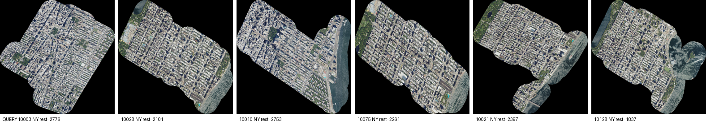
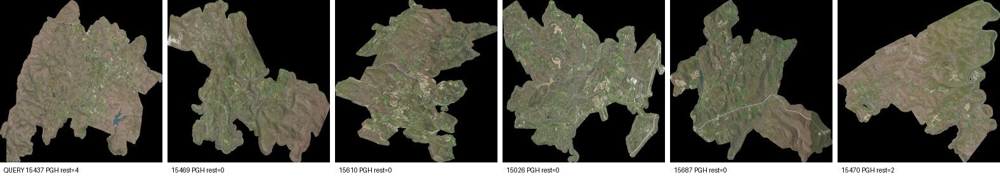

# Image pipeline QC report (Stage A)

Embedding: ResNet-50 (ImageNet1K_V2, frozen), input 448 px, mask-weighted average of the layer4 map. Empty-mask fallbacks: 0.
PCA: 16 components fitted on 17,881 images (image_year <= 2017), explaining 36.4% of scaled-embedding variance. Images centred with the image_year mean (small city-year groups): 147.

**21 of 21 checks passed.**

| Section | Check | Result | Detail |
|---|---|---|---|
| Counts | index has expected images and ZIPs, all in CSV | PASS | 35,099 images, 5,611 ZIPs |
| Counts | embedding array shape and finite | PASS | shape (35099, 2048), finite=True |
| Counts | features parquet rows and unique key | PASS | 62,260 rows (expected 62,260), 0 duplicate keys |
| Counts | has_image by year matches kept images | PASS | 2013: 5603, 2014: 5604, 2015: 5610, 2016: 5610, 2017: 5610, 2018: 5610, 2019: 5610, 2020: 5610, 2021: 5610, 2022: 5611 (PRD with all images: {2013: 5606, 2014: 5607}, then 5611) |
| Counts | has_change by year matches kept images | PASS | 2013: 382, 2014: 3049, 2015: 5550, 2016: 5601, 2017: 5609, 2018: 5609, 2019: 5609, 2020: 5609, 2021: 5609, 2022: 5610 (PRD with all images: {2013: 482, 2014: 3107}, then >= 5573) |
| Values | no row uses a partial capture (coverage < 0.5) | PASS | 1,103 of 35,099 images dropped as partial captures; 33,996 kept |
| Leakage | img_year <= year in every row with an image | PASS | max img_age 8, min 0 |
| Leakage | scaler and PCA fitted only on images <= cut-off year | PASS | fit rows 17,881, latest image year in fit 2017 |
| Leakage | no Stage A script reads a .json annotation file | PASS | only pipeline outputs referenced |
| Leakage | no Stage A script reads a price, growth or other outcome column | PASS | scanned for 34 CSV columns |
| Leakage | no row uses a 2023 image | PASS | max img_year 2022 |
| Values | level columns full where has_image=1 and empty where 0 | PASS |  |
| Values | change columns full where has_change=1 and empty where 0 | PASS |  |
| Values | non-512x512-RGB images were padded to 512x512 (not stretched) | PASS | 1,991 images (308 ZIPs) in DC; RGBA, long side 512, flattened and centre-padded with black |
| Values | raw valid_frac in (0, 1] for every image | PASS | min 0.001, median 0.584, max 0.987 |
| Values | 16 PCA components: explained variance logged | PASS | 36.4% of scaled-embedding variance |
| Values | model input list has 34 columns | PASS | 34 columns |
| Sanity | neighbours of 10003 are dense urban (restaurants >= 75th pct, 67) | PASS | 10028 (NY, 2101 restaurants), 10010 (NY, 2753 restaurants), 10075 (NY, 2261 restaurants), 10021 (NY, 2397 restaurants), 10128 (NY, 1837 restaurants) |
| Sanity | neighbours of 15437 are rural (restaurants <= median, 22) | PASS | 15469 (PGH, 0 restaurants), 15610 (PGH, 0 restaurants), 15026 (PGH, 0 restaurants), 15687 (PGH, 0 restaurants), 15470 (PGH, 2 restaurants) |
| Sanity | raw green_idx lower for Manhattan than Pittsburgh metro | PASS | Manhattan 0.048 vs PGH 0.109 |
| Sanity | rerunning 03_features.py reproduces the parquet exactly | PASS | byte-identical |

## Coverage by row year

| Year | ZIPs with image | with change | median img_age |
|---|---|---|---|
| 2013 | 5,603 | 382 | 1 |
| 2014 | 5,604 | 3,049 | 0 |
| 2015 | 5,610 | 5,550 | 0 |
| 2016 | 5,610 | 5,601 | 1 |
| 2017 | 5,610 | 5,609 | 0 |
| 2018 | 5,610 | 5,609 | 1 |
| 2019 | 5,610 | 5,609 | 0 |
| 2020 | 5,610 | 5,609 | 1 |
| 2021 | 5,610 | 5,609 | 1 |
| 2022 | 5,611 | 5,610 | 0 |

## Nearest-neighbour contact sheets

